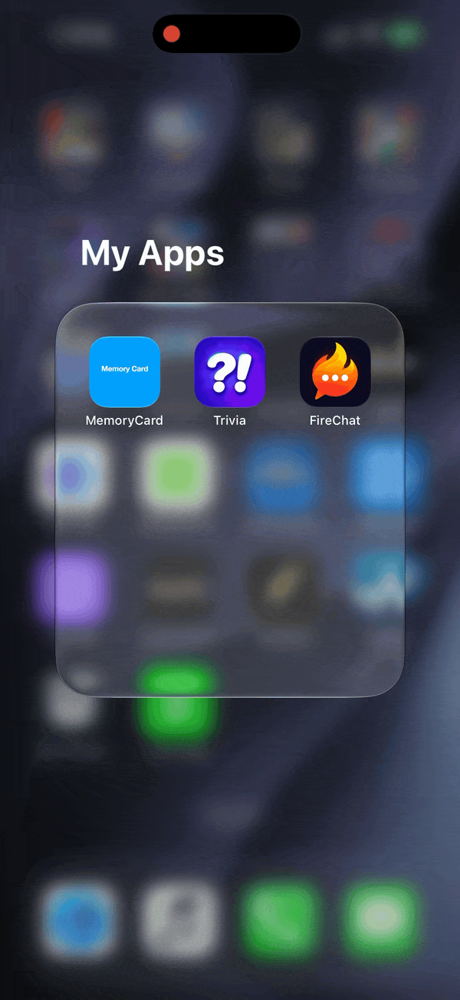

# FireChat

## By Brian Ribeiro Z23638146

FireChat is a real-time messaging app built with SwiftUI and Firebase. Users can create accounts, sign in securely,
exchange messages across devices, view timestamps, identify their own messages, and clear the chat history. 
Firebase Authentication manages users, while Cloud Firestore synchronizes messages in real time.

### What I've learned
- [x] Creating and configuring a custom server using Firebase Firestore
- [x] Setting up listeners for real-time updates
- [x] Reading and writing data from the server
- [x] Decoding fetched data into local model objects
- [x] Creating observable objects to manage fetching data and authentication
- [x] Passing observable objects in the environment

### Features
- [x] Create and send a text message to Firebase
- [x] Receive messages posted to Firebase
- [x] Distinguish if a message was sent by them or someone else based on position and color of the message

### Bonus Features
- [x] Show the user's email at the top of the chat
- [x] Display timestamps for each message
- [x] Clear the chat history
